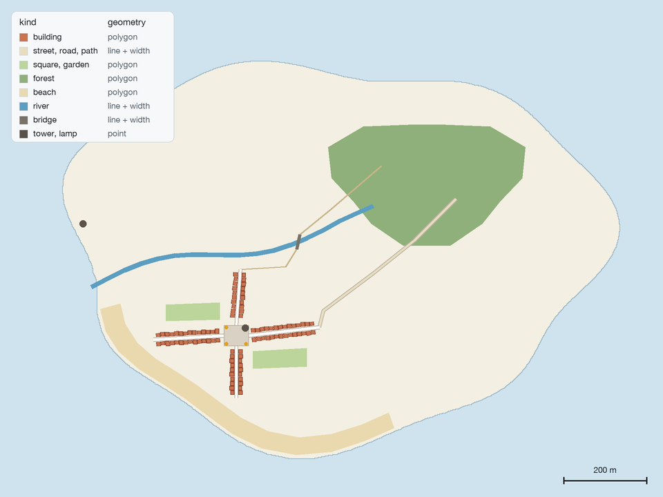
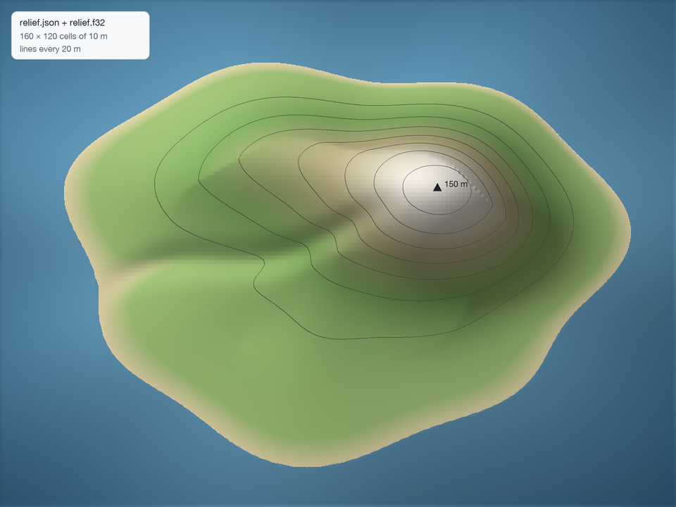
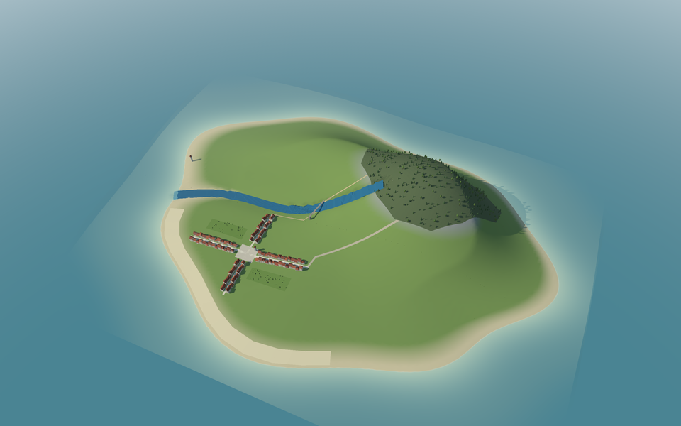
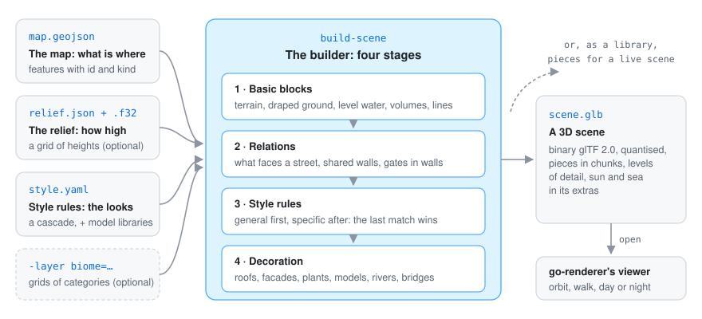

<div align="center">

# go-scene-builder

**From a flat map to a 3D scene you can walk through.** Give it any **2D map** (GeoJSON whose
features carry an `id` and a `kind`), a **relief** (a grid of heights) and **style rules** written
by you, and it writes a **3D scene** (`.glb`) that [go-renderer](https://github.com/akrck02/go-renderer)'s
viewer opens. It knows nothing about any particular world: the map and the rules do.

[](go.mod)
-informational)


</div>

## 🤖 AI disclosure

I write most of my code by hand, so I want to be clear about this project: **it was written by an
AI assistant (Claude, by Anthropic) under my direction, in October 2026.** I decided what to build
and how it should behave; the code, the tests and the documentation (with the example island and
its pictures) were written by the AI. Every commit made this way carries a
`Co-Authored-By: Claude` line (all of them).

**Status: pending thorough review.** The code compiles and its tests pass, but I have not yet
reviewed it line by line. Treat it as a working draft, not as code I vouch for.

---

<p align="center">
<picture>
  <source media="(prefers-color-scheme: dark)" srcset="docs/images/hero-dark.png">
  
</picture>
</p>

<p align="center"><sub>The example island's main street in go-renderer's viewer, built from a map, a relief and a style file: by day in light mode, at night in dark mode.</sub></p>

## ✨ What it looks like

<table>
<tr>
<th width="33%">The map you draw</th>
<th width="33%">The relief you give</th>
<th width="33%">The scene it builds</th>
</tr>
<tr>
<td>
<picture>
  <source media="(prefers-color-scheme: dark)" srcset="docs/images/map-dark.png">
  
</picture>
</td>
<td>
<picture>
  <source media="(prefers-color-scheme: dark)" srcset="docs/images/relief-dark.png">
  
</picture>
</td>
<td>

</td>
</tr>
<tr>
<td>Features with an <code>id</code> and a <code>kind</code>: polygons, lines and points.</td>
<td>A grid of heights. Without one the ground is flat.</td>
<td>Terrain, houses with roofs and facades, a river dug into the ground, trees sown on the hill.</td>
</tr>
<tr>
<td colspan="3" align="center">Change the rules, not the map: the same village in plaster and tiles, or in stone and slate (<a href="docs/style.md#the-same-map-two-looks">style rules</a>).</td>
</tr>
</table>

## 🚀 Quick start

GEOS must be installed (`pkg-config geos`). Build the example island and open it:

```bash
go run ./cmd/build-scene -map examples/island/map.geojson -relief examples/island/relief.json \
  -style examples/island/style.yaml -out island.glb

# then, in go-renderer
go run ./cmd/visor island.glb
```

Your own scene is the same command with your map, relief and rules:

```bash
go run ./cmd/build-scene -map map.geojson -relief relieve.json -style style.yaml -out scene.glb
```

[More on the example island →](docs/example.md)

## 🔍 How it works

<p align="center">
  
</p>

```
map + relief → 1 basic blocks → 2 relations → 3 style rules → 4 decoration → pieces → .glb / live scene
```

The map says *where* things are; the style rules say what they look like, read in cascade like a
style sheet. [More on the pipeline →](docs/pipeline.md)

## 📚 Documentation

| | |
|---|---|
| [The pipeline](docs/pipeline.md) | The four stages, what goes in, what comes out, and use as a library. |
| [Style rules](docs/style.md) | Selectors and values, shapes, materials, walls and roofs, houses on slopes, terrain. |
| [Decoration](docs/decoration.md) | Facades, plants, models, biomes, rivers and bridges, gates, levels of detail. |
| [The example island](docs/example.md) | A small made-up island to build, look at and change. |

Everything starts at the [documentation index](docs/README.md).
