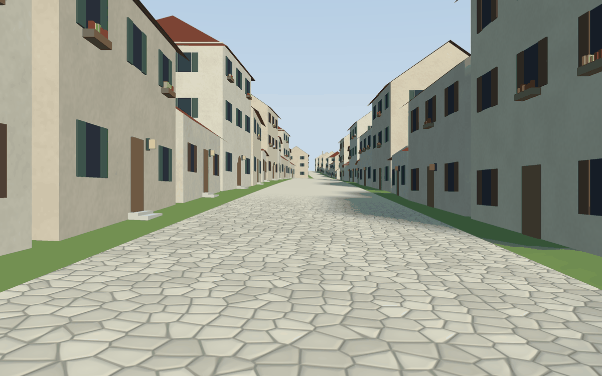

# Welcome to go-scene-builder 👋

**go-scene-builder turns a flat map into a 3D scene you can walk through**: you say *what is where* (a house here, a street there) and *what things look like* (stone walls, red roofs), and it builds the village.

<p align="center"></p>

It reads three things: a **map** (the outlines of houses, streets, rivers), a **relief** (how high the ground is) and **style rules** (a text file saying what each kind of thing looks like). It writes a `.glb` scene that go-renderer's viewer opens. Change the rules and the same map becomes another village.

## Is it for me?

- ✅ You have a **map** and want to **see it in 3D**.
- ✅ You want to design how a place looks **by writing rules**, not by modelling every house.
- ✅ You are **not a programmer**: maps and rules are text files, no code needed.

## Where to start

Pick the line that sounds like you.

| If you… | Read | Time |
|---|---|---|
| want to **see** an example right away | [The example island](3-the-example-island.md) | 5 min |
| are **new** and want to build something | 🏴‍☠️ [The quest](2-the-quest.md): a village from a map, in 6 levels | 60 min |
| want to know **what goes in and out** | [The pipeline](4-the-pipeline.md) | 10 min |
| want to **write style rules**: roofs, walls, materials | [Style rules](5-style-rules.md) | — |
| want **facades, trees, lamps, rivers, gates** | [Decoration](6-decoration.md) | — |

## Try it without writing code

Everything here is text files and two commands: one builds the scene, the other opens it.

```sh
go run ./cmd/build-scene -map map.geojson -style style.yaml -out village.glb
go run ../go-renderer/cmd/visor village.glb
```

The [quest](2-the-quest.md) gives you the files to start from.

## All the pages, in reading order

The menu on the left (or the files in `docs/`) follows this order.

**Start**

- [Overview](1-overview.md): this page
- [The quest](2-the-quest.md): six levels, from one house to a walled town
- [The example island](3-the-example-island.md)

**Guides**

- [The pipeline](4-the-pipeline.md): the four stages
- [Style rules](5-style-rules.md)
- [Decoration](6-decoration.md)

## 🚧 Not done yet

- Balconies and more decorations.

## Words you will meet

| Word | What it means |
|---|---|
| Terminal | The window where you type commands: *Terminal* on macOS and Linux, *PowerShell* on Windows. |
| Repository | A project's folder of files, kept on GitHub. `git clone <address>` copies it to your computer. |
| Scene | Everything a 3D picture holds: ground, houses, trees, the sea, the sky and the sun. |
| `.glb` file | A 3D scene in one file, in the open glTF format: many programs (Blender among them) open and write it. |
| Quest | The tutorial of these docs: short levels, each ending with something that works and an achievement. |

## The family

go-scene-builder is one of a family of small projects that work together:

| Project | What it does |
|---|---|
| [go-renderer](https://github.com/akrck02/go-renderer) | draws 3D scenes and flat interfaces |
| [go-ui](https://github.com/akrck02/go-ui) | buttons, panels and whole applications |
| [go-ui-android](https://github.com/akrck02/go-ui-android) | Android apps that look like Android's own |
| [go-sound](https://github.com/akrck02/go-sound) | sound and music |
| **go-scene-builder** (this one) | 3D scenes from a flat map |
| [go-simulator](https://github.com/akrck02/go-simulator) | simulations that change a scene |
| [go-simulator-terrain](https://github.com/akrck02/go-simulator-terrain) | ground shaped by rivers |
| [go-simulator-climate](https://github.com/akrck02/go-simulator-climate) | weather and biomes |
| [go-simulator-flora](https://github.com/akrck02/go-simulator-flora) | forests that grow |
| [go-simulator-urban](https://github.com/akrck02/go-simulator-urban) | towns that grow |
| [go-simulator-motion](https://github.com/akrck02/go-simulator-motion) | a scene that moves |
| [go-3ds](https://github.com/akrck02/go-3ds) | Go on the Nintendo 3DS |

> ⚠️ All of them are **educational experiments**, written with an AI assistant and pending review by their author: good for learning and playing, not for production.
