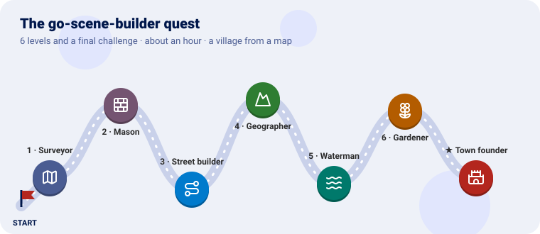
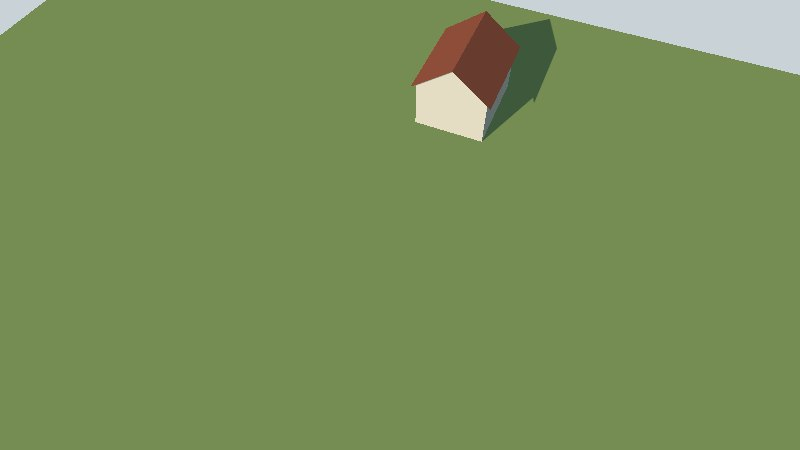
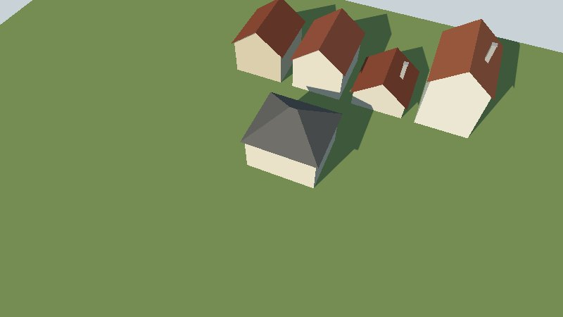
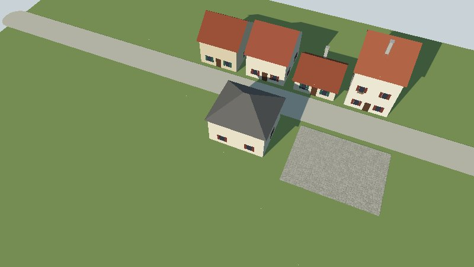
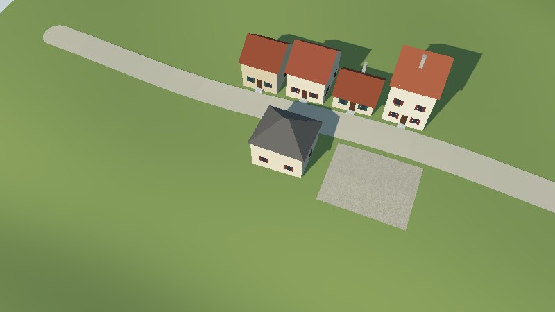
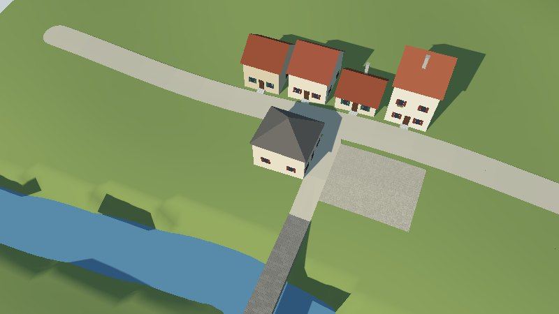
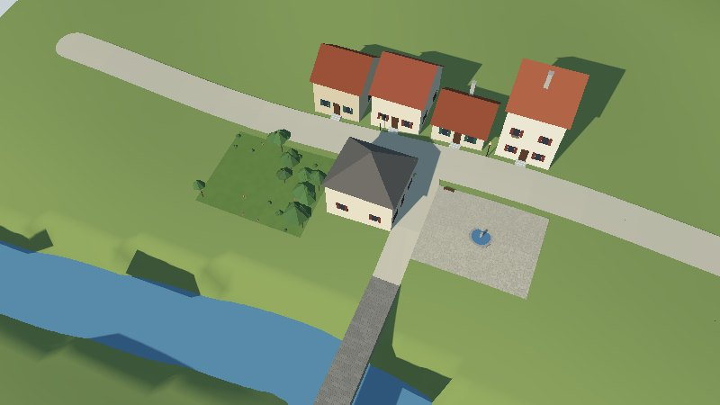
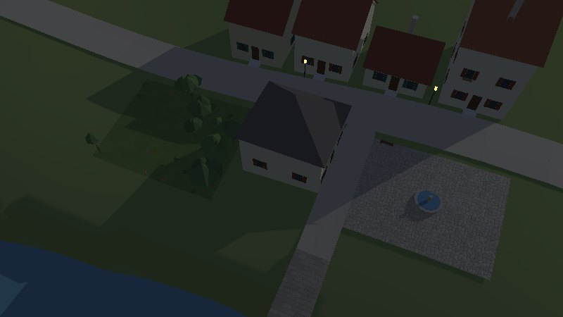
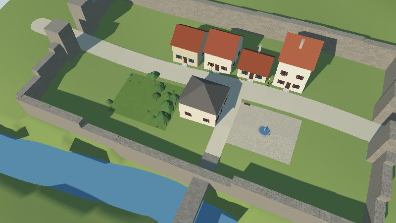
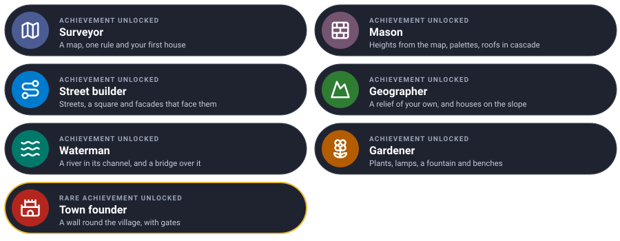

# The Go Scene Builder quest

Turn a flat map into a village you can walk through, one level at a time. Each level teaches one
piece of Go Scene Builder and ends with a new scene in Go Renderer's viewer.



We will build a **village**: houses along a street, a square with a fountain, a garden, a river
with a bridge, lamps that light up at night, and in the end a wall round it all, with gates.

---

Every level has the same shape: **the idea** (explained with something from everyday life), **the
files**, a **checkpoint** to know it works, and an optional **bonus**. You write two files and keep
growing them: `map.geojson` (what is where) and `style.yaml` (what things look like).

---

## Before you start

You need Go 1.25, GEOS (`sudo apt install libgeos-dev`, `brew install geos`) and Go Renderer's
viewer to look at the result:

```sh
git clone https://github.com/akrck02/go-scene-builder
git clone https://github.com/akrck02/go-renderer
mkdir village && cd village
```

Keep two commands at hand; after each change, build and look:

```sh
# build the scene
go run ../go-scene-builder/cmd/build-scene -map map.geojson -style style.yaml -out village.glb
# look at it: drag to turn, scroll to zoom, Tab to walk, N for the night
go run ../go-renderer/cmd/visor village.glb
```

The pictures were taken with `-look-at 0,0 -zoom 0.45` added to the viewer.

This is where everything will live by the end:

```
village/
├── map.geojson      ← every level
├── style.yaml       ← every level
├── relief/main.go   ← level 4: writes the two files below
├── relieve.json
├── relieve.f32
└── models.yaml      ← level 6
```

---

## Level 1 · The Surveyor

| Mission | Pieces | Time |
|---|---|---|
| One house on a meadow | GeoJSON features, `ground` and `volume` shapes, a gable roof | 8 min |

#### The idea

A **surveyor** draws a plan: this outline is a house, that one a field. The plan says **where**,
never **how it looks**. That is the style's job, like a **dress code** for a party: "houses wear
cream walls and a red roof". Change the dress code and the same plan becomes another village.

Every feature on the map has an `id` (its name, stable from one version to the next) and a `kind`
(a free word: `house`, `meadow`; the style gives it a meaning).

#### Build it

`map.geojson`, in metres, x to the east and y to the north, centred ten metres south of zero:

```json
{
  "type": "FeatureCollection",
  "properties": {"units": "m", "axes": "east-north", "origin": [0, -10]},
  "features": [
    {"type": "Feature", "properties": {"id": "meadow", "kind": "meadow"}, "geometry": {"type": "Polygon", "coordinates": [[[-60, 30], [60, 30], [60, -60], [-60, -60], [-60, 30]]]}},
    {"type": "Feature", "properties": {"id": "house-1", "kind": "house", "floors": 2}, "geometry": {"type": "Polygon", "coordinates": [[[-4, 4], [4, 4], [4, 14], [-4, 14], [-4, 4]]]}}
  ]
}
```

`style.yaml`:

```yaml
units: m
environment: {sun: [220, 35]}
rules:
  - when: {kind: meadow}
    shape: {role: ground}
    color: "#8fa35a"
  - when: {kind: house}
    shape: {role: volume, height: 6}
    walls: {color: "#e9dfc9"}
    roof: {recipe: gable, pitch: 38, color: "#a4553a"}
```

`ground` drapes a polygon over the ground; `volume` raises a block from it, `height` metres up to
where the roof starts.

#### Checkpoint

The build prints `[ground 1 volume 1]`, and the viewer shows a cream house with a red roof on a
green meadow.



#### Bonus (optional): a flat roof

Make the house a modern box with a flat roof and grey walls.

<details>
<summary>🔓 Show the solution</summary>

<pre><code>walls: {color: "#9e9e99"}
roof: {recipe: flat}</code></pre>

</details>


Learn more: [The pipeline](4-the-pipeline.md) · [Style rules](5-style-rules.md)

---

## Level 2 · The Mason

| Mission | Pieces | Time |
|---|---|---|
| Five houses, each its own height and colour | properties, arithmetic, palettes, the cascade | 8 min |

#### The idea

Rules work like a **style sheet**, in **cascade**: every rule that matches adds its values, and
when two say the same thing, the later one wins. Write the general look first ("houses have gable
roofs") and the exceptions after ("shops have hip roofs").

A **palette** is a box of paint pots: each house takes one, always the same one for the same id,
so the street does not look painted from one bucket.

#### Build it

Add four houses to the map's features (the map can say anything the style reads: here `floors` and
`use`):

```json
{"type": "Feature", "properties": {"id": "house-2", "kind": "house", "floors": 1}, "geometry": {"type": "Polygon", "coordinates": [[[6, 4], [14, 4], [14, 12], [6, 12], [6, 4]]]}},
{"type": "Feature", "properties": {"id": "house-3", "kind": "house", "floors": 3}, "geometry": {"type": "Polygon", "coordinates": [[[16, 4], [24, 4], [24, 15], [16, 15], [16, 4]]]}},
{"type": "Feature", "properties": {"id": "house-4", "kind": "house", "floors": 2}, "geometry": {"type": "Polygon", "coordinates": [[[-14, 4], [-6, 4], [-6, 13], [-14, 13], [-14, 4]]]}},
{"type": "Feature", "properties": {"id": "house-5", "kind": "house", "floors": 2, "use": "shop"}, "geometry": {"type": "Polygon", "coordinates": [[[-4, -4], [6, -4], [6, -13], [-4, -13], [-4, -4]]]}}
```

Replace the house rule, and add the shop's exception after it:

```yaml
  - when: {kind: house}
    shape: {role: volume, height: "3 + (floors - 1) * 3"}
    walls: {color: ["#e9dfc9", "#efe4cf", "#e2d2b4", "#f1ead9"]}
    roof: {recipe: gable, pitch: 38, ridge: long, eaves: 0.4, color: ["#a4553a", "#9a4b33", "#b0613f"], chimneys: {share: 0.5}}
    stonework: {plinth: 0.6, quoins: true}
  - when: {kind: house, use: shop}
    roof: {recipe: hip, color: "#6f6a64"}
```

`"3 + (floors - 1) * 3"` reads each house's `floors`: three metres for the ground floor and three
for each one above. `chimneys: {share: 0.5}` puts one on half of the houses; `stonework` adds a stone
base and corner stones.

#### Checkpoint

Five houses of one, two and three floors, in slightly different creams and reds, two with chimneys;
the shop's roof is grey and slopes on four sides.



#### Bonus (optional): tall shops

Shops with three floors or more get darker walls. Selectors take a number range.

<details>
<summary>🔓 Show the solution</summary>

<pre><code>  - when: {kind: house, use: shop, floors: {min: 3}}
    walls: {color: "#cdbb98"}</code></pre>

It goes after the other shop rule, so it wins.

</details>


---

## Level 3 · The Street builder

| Mission | Pieces | Time |
|---|---|---|
| A street, a square, and doors facing the street | lines with a width, materials, relations, facades | 10 min |

#### The idea

A house alone does not know where its front door goes. It needs to **look around**: which of its
sides faces a street? That is a **relation**, worked out between blocks after they are built, like
neighbours who know which house is opposite. The **facade** recipe then dresses that side with a
door, windows with shutters and flower boxes.

#### Build it

Add a street (a line, widened by its `width`) and a square:

```json
{"type": "Feature", "properties": {"id": "high-street", "kind": "street", "width": 6}, "geometry": {"type": "LineString", "coordinates": [[-60, 0], [60, 0]]}},
{"type": "Feature", "properties": {"id": "square", "kind": "square"}, "geometry": {"type": "Polygon", "coordinates": [[[10, -4], [26, -4], [26, -16], [10, -16], [10, -4]]]}}
```

The whole style now:

```yaml
units: m
environment: {sun: [220, 35]}
relations:
  facing: {when: {kind: street}, reach: 20}
rules:
  - when: {kind: meadow}
    shape: {role: ground}
    color: "#8fa35a"
  - when: {kind: street}
    shape: {role: ground, width: "width", lift: 0.3}
    color: "#d8cdb4"
  - when: {kind: square}
    shape: {role: ground, lift: 0.3}
    color: "#c9bfa8"
    material: {pattern: cobbles, scale: 0.4}
  - when: {kind: house}
    shape: {role: volume, height: "3 + (floors - 1) * 3"}
    walls: {color: ["#e9dfc9", "#efe4cf", "#e2d2b4", "#f1ead9"]}
    roof: {recipe: gable, pitch: 38, ridge: along_street, eaves: 0.4, color: ["#a4553a", "#9a4b33", "#b0613f"], chimneys: {share: 0.5}}
    stonework: {plinth: 0.6, quoins: true}
    facade:
      door: {color: "#5b3a26", round: 0.5}
      windows: {shutters: ["#2f5d50", "#7a3b2e"]}
      flower_boxes: {share: 0.5, flowers: ["#d23c4f", "#f2c14e"]}
      sides: {spacing: 4.5}
  - when: {kind: house, use: shop}
    roof: {recipe: hip, color: "#6f6a64"}
```

- `relations.facing`: sides within 20 metres of a street face it.
- `lift: 0.3` keeps the street a little over the meadow, so the two do not flicker.
- `material: {pattern: cobbles}` draws paving stones on the square with no texture: Go Renderer
  makes the pattern as it draws.
- `ridge: along_street`: the roof's ridge runs along the street.
- `facade.sides` gives the other walls plainer windows, further apart.

#### Checkpoint

The build says `5 facing a street`. Each house has a door and windows on its street side, some with
flowers; the square is paved.



#### Bonus (optional): ivy and lamps by the doors

<details>
<summary>🔓 Show the solution</summary>

<pre><code>    facade:
      …
      ivy: {share: 0.3}
      lamp: {}</code></pre>

Ivy is a foliage material: it takes the season's colour when a simulation sets one.

</details>


Learn more: [Decoration: facades](6-decoration.md#facades)

---

## Level 4 · The Geographer

| Mission | Pieces | Time |
|---|---|---|
| Ground with a slope, and houses that stand on it | the relief, terrain colours | 10 min |

#### The idea

A **relief** is a **chessboard of heights**: every square says how high the ground is there. It
lives in two files: a small label (`relieve.json`: how many squares, how big, where) and the
heights themselves (`relieve.f32`: one number per square, row by row from the north).

Houses on a slope stand halfway between their lowest and highest corners: cut into the hill uphill,
on a stone base downhill.

#### Build it

Write the relief with a small Go program, `relief/main.go`:

```go
// Command relief writes the ground the village stands on: relieve.json, the grid's size and
// place, and relieve.f32, a height in metres for every cell, row by row from the north.
package main

import (
	"encoding/binary"
	"encoding/json"
	"log"
	"math"
	"os"
)

func main() {
	const (
		columns, rows = 80, 70 // cells
		cell          = 2.0    // metres a side
		west, north   = -80.0, 70.0
	)
	heights := make([]float32, 0, columns*rows)
	for row := range rows {
		for column := range columns {
			east := west + (float64(column)+0.5)*cell
			northing := north - (float64(row)+0.5)*cell
			heights = append(heights, float32(height(east, northing)))
		}
	}
	header := map[string]any{"columns": columns, "rows": rows, "cell": cell, "west": west, "north": north, "units": "m"}
	content, _ := json.Marshal(header)
	if err := os.WriteFile("relieve.json", content, 0o644); err != nil {
		log.Fatal(err)
	}
	file, err := os.Create("relieve.f32")
	if err != nil {
		log.Fatal(err)
	}
	defer file.Close()
	if err := binary.Write(file, binary.LittleEndian, heights); err != nil {
		log.Fatal(err)
	}
}

// height is a slope rising to the north, a little rolling, down to a valley in the south.
func height(east, north float64) float64 {
	slope := 0.12 * north
	rolling := 1.5 * math.Sin(east/14) * math.Cos(north/18)
	valley := -4 * math.Exp(-math.Pow((north+38)/14, 2))
	return 20 + slope + rolling + valley
}
```

```sh
go mod init example.com/village   # once, for the program
go run ./relief                   # writes relieve.json and relieve.f32
```

The terrain now replaces the meadow: **remove the meadow** from the map and its rule from the
style, and add to the style, under `environment`:

```yaml
terrain: {color: "#8fa35a", bands: [{above: 26, color: "#7d8f4c", blend: 3}]}
```

Build with the relief:

```sh
go run ../go-scene-builder/cmd/build-scene -map map.geojson -relief relieve.json -style style.yaml -out village.glb
```

#### Checkpoint

The ground rises to the north and rolls a little; the street follows it, the houses stand on it
with stone bases where it falls away, and the ground is darker above 26 metres.



#### Bonus (optional): snowy tops

<details>
<summary>🔓 Show the solution</summary>

Add a band: `{above: 30, color: "#f2f2f0", blend: 2}` after the first.

</details>


Learn more: [Houses on slopes](5-style-rules.md#houses-on-slopes) · [The pipeline: what goes in](4-the-pipeline.md#what-goes-in)

---

## Level 5 · The Waterman

| Mission | Pieces | Time |
|---|---|---|
| A river in the valley, and a bridge over it | `water` shapes, level lines | 8 min |

#### The idea

Water always lies **level**, and a river **digs its own bed**: with a relief, the builder cuts a
channel so the water stays under its banks and never runs uphill. A bridge is a **plank laid
level** from one bank to the other, high enough for the water to pass under.

#### Build it

Add the river, the bridge and a lane from the street to it:

```json
{"type": "Feature", "properties": {"id": "river", "kind": "river", "width": 10}, "geometry": {"type": "LineString", "coordinates": [[-60, -40], [0, -32], [60, -44]]}},
{"type": "Feature", "properties": {"id": "bridge", "kind": "bridge", "width": 4}, "geometry": {"type": "LineString", "coordinates": [[8, -20], [8, -52]]}},
{"type": "Feature", "properties": {"id": "lane", "kind": "street", "width": 4}, "geometry": {"type": "LineString", "coordinates": [[8, -4], [8, -20]]}}
```

And two rules, before the houses:

```yaml
  - when: {kind: river}
    shape: {role: water, width: "width"}
  - when: {kind: bridge}
    shape: {role: line, follow: level, thickness: "width", height: 0.5}
    color: "#9c9486"
    material: {pattern: masonry, scale: 0.5}
```

#### Checkpoint

A blue river crosses the valley in the south, in a channel of its own; a stone bridge carries the
lane over it.



#### Bonus (optional): the sea

<details>
<summary>🔓 Show the solution</summary>

`environment: {sun: [220, 35], water_level: 16}` adds a sea at 16 metres: the low ground floods.

</details>


Learn more: [Rivers and bridges](6-decoration.md#rivers-and-bridges)

---

## Level 6 · The Gardener

| Mission | Pieces | Time |
|---|---|---|
| A garden, lamps that light at night, a fountain and benches | plants, model libraries, glow | 10 min |

#### The idea

A **model library** is a **box of toys**: a lamp, a fountain, a bench, each built once from simple
parts (boxes, cylinders, cones, blobs). The map places them, or a recipe **sows** them over a
ground, and Go Renderer draws every copy of a toy in one go, so a hundred cost no more than one.

#### Build it

`models.yaml`, in metres, the origin on the ground:

```yaml
models:
  lamp:
    parts:
      - {shape: cylinder, radius: 0.06, height: 3, color: "#2b2b2b"}
      - {shape: box, size: [0.3, 0.4, 0.3], at: [0, 3, 0], color: "#ffd98a", material: {kind: glow}}
  fountain:
    parts:
      - {shape: cylinder, radius: 1.6, height: 0.5, sides: 16, color: "#b9b2a5"}
      - {shape: cylinder, radius: 1.3, height: 0.52, sides: 16, color: "#5d8fb0"}
      - {shape: cylinder, radius: 0.2, height: 1.4, color: "#b9b2a5"}
  bench:
    parts:
      - {shape: box, size: [1.6, 0.08, 0.4], at: [0, 0.42, 0], color: "#6b4a2e"}
      - {shape: box, size: [0.1, 0.42, 0.4], at: [-0.7, 0, 0], color: "#3b3b3b"}
      - {shape: box, size: [0.1, 0.42, 0.4], at: [0.7, 0, 0], color: "#3b3b3b"}
```

The lamp's glass is `glow`: it shines in the dark. Add a garden, two lamps and the fountain:

```json
{"type": "Feature", "properties": {"id": "garden", "kind": "garden"}, "geometry": {"type": "Polygon", "coordinates": [[[-24, -4], [-6, -4], [-6, -18], [-24, -18], [-24, -4]]]}},
{"type": "Feature", "properties": {"id": "lamp-1", "kind": "lamp"}, "geometry": {"type": "Point", "coordinates": [-2, 3]}},
{"type": "Feature", "properties": {"id": "lamp-2", "kind": "lamp"}, "geometry": {"type": "Point", "coordinates": [15, 3]}},
{"type": "Feature", "properties": {"id": "fountain", "kind": "fountain"}, "geometry": {"type": "Point", "coordinates": [18, -10]}}
```

In the style, name the library after `units`:

```yaml
models: [models.yaml]
```

and add, before the houses:

```yaml
  - when: {kind: garden}
    shape: {role: ground, lift: 0.05}
    color: "#6f8f44"
    material: {pattern: grass, scale: 0.5}
    decorate: [{recipe: plants, density: 0.2, trees: 0.3, beds: 0.3, clear: 1}]
  - when: {kind: lamp}
    shape: {role: model, model: lamp}
  - when: {kind: fountain}
    shape: {role: model, model: fountain}
  - when: {kind: square}
    decorate: [{recipe: scatter, density: 0.01, models: {bench: 1}, edge: true}]
```

The square's second rule adds to the first: the cascade again.

#### Checkpoint

Shrubs, trees and flower beds in the garden, a fountain in the square, benches at its edge, lamps
by the street. Press `N` in the viewer: the lamps glow.





#### Bonus (optional): a flowerbed of lilies

Sow lilies over the garden, with a model of your own.

<details>
<summary>🔓 Show the solution</summary>

<pre><code>  lily:
    parts:
      - {shape: cylinder, radius: 0.01, height: 0.35, color: "#4f6b35"}
      - {shape: petals, count: 6, length: 0.07, width: 0.035, tilt: 35, at: [0, 0.35, 0], color: ["#7da7e0", "#f2f0e8"]}</code></pre>

and in the garden's `decorate`: `{recipe: scatter, density: 0.5, models: {lily: 1}, group: 8}`.

</details>


Learn more: [Models](6-decoration.md#models) · [Plants](6-decoration.md#plants)

---

## Final challenge · Town founder

Build a **wall** round the village, 7 metres high with battlements, and a **gate** with a tower at
each side wherever the street goes through it.

> **Hint:** the wall is a closed line on the map, its `kind` is `wall`. A line shape has `height`
> and `thickness`; `openings: {where: …, width}` cuts gaps where a street crosses, and the
> `gate_towers` recipe stands towers beside them.

Try it on your own first, then compare with the solution.



<details>
<summary>🔓 Show the solution</summary>

<pre><code>{"type": "Feature", "properties": {"id": "wall", "kind": "wall"}, "geometry": {"type": "LineString", "coordinates": [[-45, 22], [45, 22], [45, -26], [-45, -26], [-45, 22]]}}</code></pre>

<pre><code>  - when: {kind: wall}
    shape: {role: line, height: 7, thickness: 2}
    color: "#a59c8c"
    material: {pattern: masonry, scale: 0.6}
    battlements: {height: 1, width: 1, gap: 1}
    openings: {where: {kind: street}, width: 6}
    decorate: [{recipe: gate_towers, size: 5, height: 11}]</code></pre>

</details>


---

## Well done



You turned a few lines of JSON into a village with a river, gardens and walls, and every look in it
comes from rules you wrote.

### Ideas to keep going

| Idea | Difficulty | Hint |
|---|---|---|
| A second street, and houses facing both | ⭐ | Another `street` line; the relations do the rest |
| A round tower | ⭐ | A point with `shape: {role: point, size: 8, height: 15, form: round}` |
| A forest by biome | ⭐⭐ | A layer of categories, `-layer biome=biomes.json`, and `terrain.biomes` ([biomes](6-decoration.md#biomes)) |
| A model made in Blender | ⭐⭐ | `file: lamp.glb` in the library, in metres, y up |
| A town that grows by itself | ⭐⭐⭐ | Go Simulator's urban plugin builds on the same rules |

## Troubleshooting

| You see | Why, and what to do |
|---|---|
| `pkg-config: geos not found` | Install GEOS: `libgeos-dev` on Debian and Ubuntu, `geos` with Homebrew |
| The build lists a feature among its first warnings | No rule styles its `kind`, or a value is wrong: the warning says which |
| The viewer shows nothing, or only grey | Every feature is `none`, or far from `origin`: check the map's `origin` and units |
| A street flickers over the ground | Give it a `lift` (a few tenths of a metre) |
| `0 facing a street` | `relations.facing` is missing, or its `reach` is too short for the gap between houses and street |
| Houses float or sink | Without a relief the ground is flat; with one, check that the relief covers the whole map |

---

[← All the documentation](1-overview.md)
