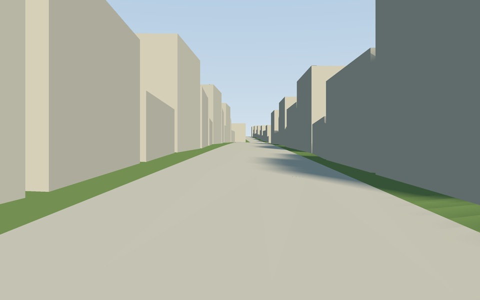
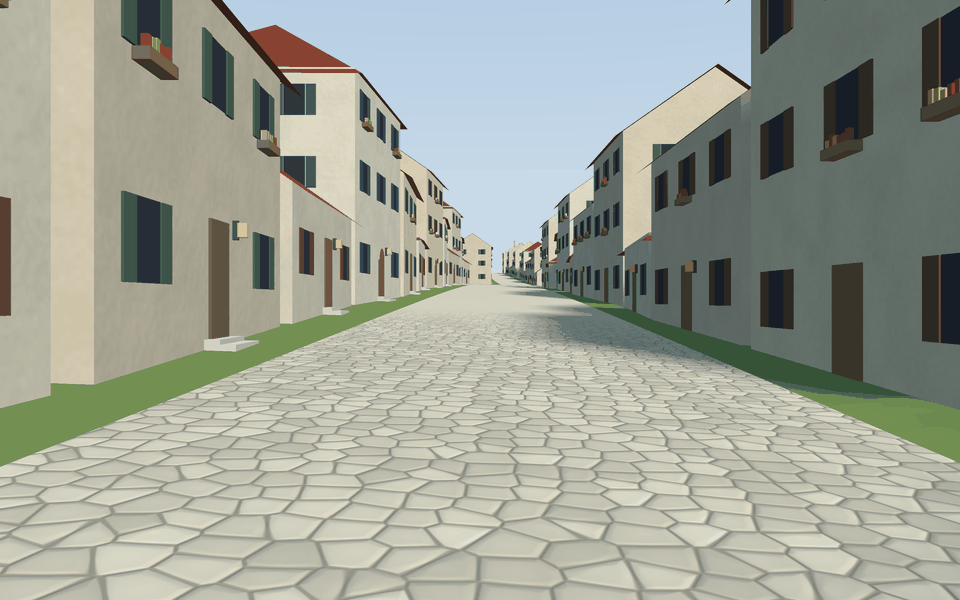
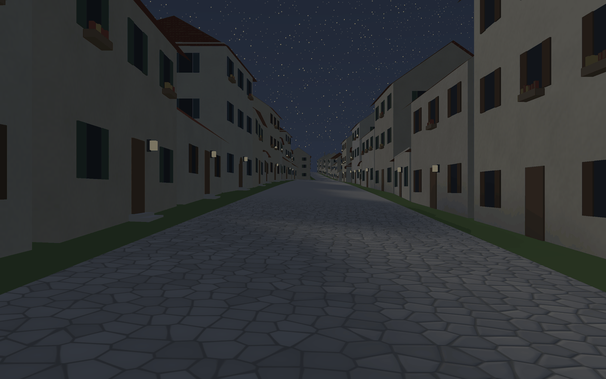
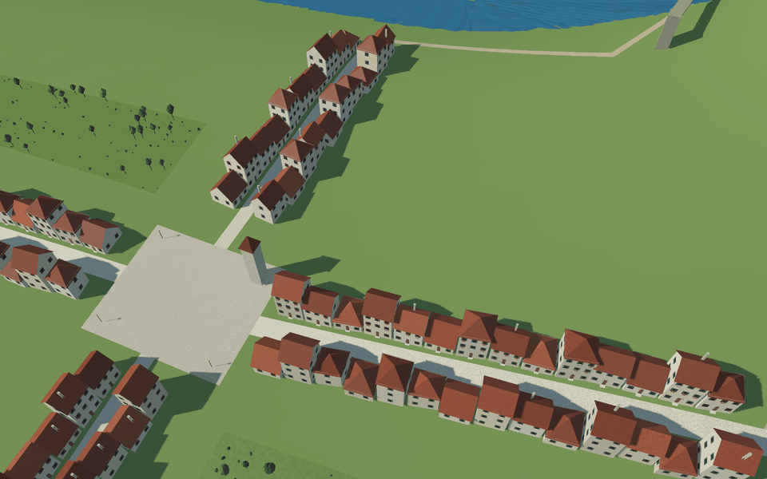
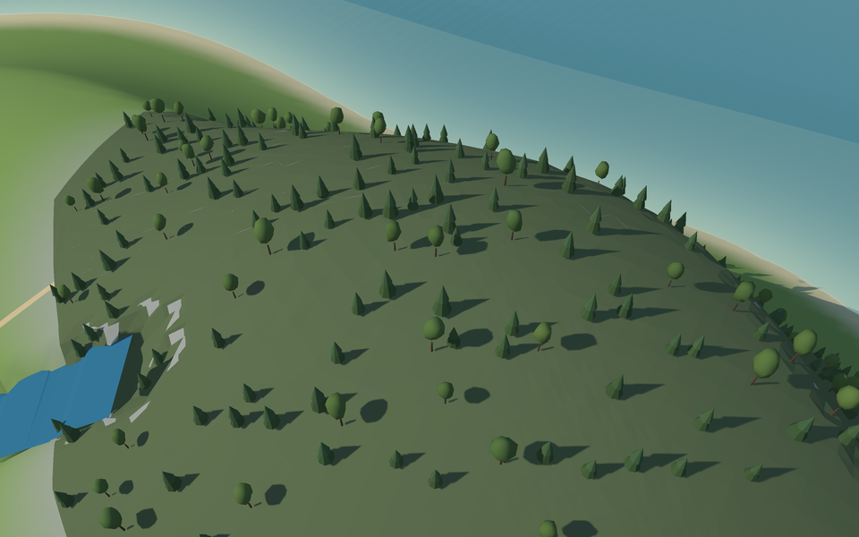

# 🌳 Decoration

A town of plain boxes is not a town. Decoration recipes add what makes it believable: doors and
windows on the side that faces the street, flower boxes, lamps, trees in the gardens, towers at the
gates, bridges that clear the river. They all follow the style rules, so you choose how much of each.

<table>
<tr>
<th width="50%">Before: <code>style-plain.yaml</code></th>
<th width="50%">After: <code>style.yaml</code></th>
</tr>
<tr>
<td></td>
<td></td>
</tr>
<tr>
<td colspan="2" align="center">The same map and relief; only the style differs (the <a href="3-the-example-island.md">example island</a>).</td>
</tr>
</table>

## Facades

`facade` dresses the side of a volume that faces a street:

- `door` (`round`: the share with a rounded top), `windows` (with `shutters`), `frames` (stone
  around windows and doors);
- `flower_boxes` (with `flowers`, some `glowing`), `baskets` beside the door, `ivy` climbing the wall
  (a foliage material that takes the season);
- `emblem`: a six-petal flower in relief above the door, a town's badge; `lamp`.

With `facade: {sides: {spacing: 4.5}}` the other open walls (gables, backs, houses at the back of a
plot) get plainer windows, further apart and without a door. Window glass is a single pane.

<p align="center">
  
</p>

<p align="center"><sub>At night the <code>glow</code> materials light up: the lamps beside the doors and the flower boxes marked <code>glowing</code>.</sub></p>

## Plants

On ground features, `decorate: [{recipe: plants, …}]` sows shrubs, trees and flower beds, never on
a volume.

<p align="center">
  
</p>

## Models

Small models (flowers, lamps, benches, trees…) live in libraries the style names
(`models: [models.yaml]`) and are drawn as **instances**: one mesh, many copies, so a forest costs
almost nothing. A model is made of parts (`box`, `cylinder`, `cone`, `blob`, `petals`, `ogive`) with
colours and materials, or read from a binary glTF made elsewhere (`file: lamp.glb`, in metres,
y up).

- Place them on points: `shape: {role: model, model: lamp, scale: [0.9, 1.1], turn: random}`.
- Sow them on ground features:
  `decorate: [{recipe: scatter, density: 0.01, models: {lily: 3, lamp: 1}, group: 8}]`.

<p align="center">
  
</p>

<p align="center"><sub>The example island's forest: <code>scatter</code> with two models of the library, <code>fir</code> and <code>broadleaf</code>, each built in variants.</sub></p>

**Variety.** A model can be built in several variants (`variants: 3`): its parts move (`move`,
metres) and change size (`grow`, a share) a little in each, and blobs bend out of round their own
way (`wobble`; `smooth: false` for faceted, `rings` for how finely they are cut). Every copy picks
a variant and changes its colour, warmth and size (`vary: {color: 0.12, warmth: 0.06, scale: [0.8,
1.3]}`). Cylinders can narrow to `top_radius` (trunks), and parts can be tipped over (`roll`,
degrees), so a cylinder can be a wheel.

**Gates as models.** The `ogive` part is a pointed arch (width, straight sides, depth; with
`border`, a frame), so a gate can be built as a model and placed on a point; `gate_towers` then
skips the gates near points of that kind (`except_near: main_gate`).

**Keeping out of the way.** Decorations keep off blocks (`clear`), lines with a width
(`keep_off_lines`), models placed on their own and each other (`spacing`), and can keep to the edge
of their feature (`edge`).

## Biomes

A layer of categories (`-layer biome=biomes.json`) colours the terrain and sows vegetation: in the
style, `terrain.biomes` gives each biome a colour and, optionally, `decorate` recipes that cover
its cells, never on the map's polygons nor on its wide lines (rivers, roads).

```yaml
terrain:
  biomes:
    conifers: {color: "#5b6a49", decorate: [{recipe: scatter, density: 0.00015, models: {fir: 1}, scale: [3, 5]}]}
    meadow: {color: "#b7b47f"}
```

## Rivers and bridges

Rivers always run below the ground around them. With a relief, every water feature with an axis and
a width digs its channel: the water lies `freeboard` metres (0.6) under the lower bank and never
rises downstream, the bed is `depth` metres (2) under it, and the ground meets the water at the
river's edge. Bridges (`follow: level` lines) that cross water keep their underside `clearance`
metres (1.5) over it, reach out to dry ground and stand on abutments. In a live scene, where the
terrain exists already, the water stays `above_bed` metres over the ground of its axis and bridges
still clear it.

## Tall walls and gates

Wall lines can carry battlements along their top (`battlements: {height, width, gap}`), and the
`gate_towers` recipe can close each gate above an arch (`arch`: metres from the ground), so a tall
wall keeps its gate a gate.

## Levels of detail and file size

Pieces carry simpler versions for when they look small on screen, and go-renderer picks one: the
terrain is written at full resolution and at every 2nd, 4th and 8th vertex, with skirts under the
chunk edges; facade details and plants hide from far away; models can declare simpler versions
(`levels: [{below: 0.06, parts: […]}, {below: 0.006}]`, no parts = not drawn).

To keep files light, quads share their four vertices, instanced models are written once for every
chunk that uses them, corner stones are one column per corner, and boxes standing on the ground have
no underside: the same town weighs about half.
