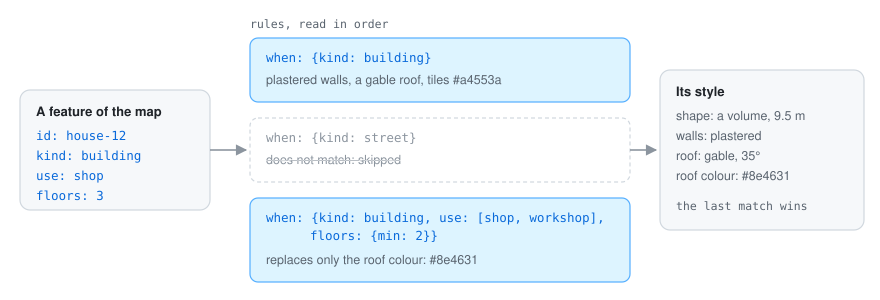
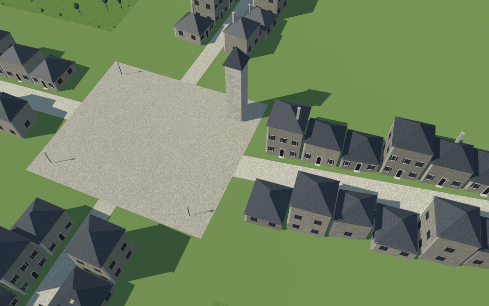

# 🎨 Style rules

Style rules are where you decide what things look like. They are a YAML file read **in cascade**,
like a style sheet: every rule whose selector matches a feature adds or replaces values, and the
last one wins. So you write the general look first ("buildings are plastered, with tiled roofs")
and then the exceptions ("shops with three floors or more have darker roofs").

<p align="center">
  
</p>

## A complete example

```yaml
units: m
chunk: 0.5                             # km: pieces are grouped in squares this big (larger for larger maps)
environment: {sun: [235, 38]}          # azimuth and elevation in degrees; water_level adds a sea;
                                       # vertical_scale exaggerates the relief seen from above
models: [models.yaml]                  # libraries of small models (see decoration)
terrain: {color: "#6b7f47", bands: [{above: 350, color: "#9e9e99", blend: 30}]}
relations:
  facing: {when: {kind: street}, reach: 20}   # which side of a block looks onto a street
  rows: {tolerance: 0.4}                       # walls closer than this are shared (not drawn)
rules:
  - when: {kind: street}
    shape: {role: ground, width: "width * 1000", lift: 0.12}
    color: "#e6dcc4"
  - when: {kind: river}
    shape: {role: water, width: "width * 1000", above_bed: 1.8}
  - when: {kind: building}
    shape: {role: volume, height: "3.5 + (floors - 1) * 3"}
    walls: {color: "#e9dfc9"}
    roof: {recipe: gable, pitch: 38, ridge: long, eaves: 0.5, color: "#a4553a"}
  - when: {kind: building, use: [shop, workshop], floors: {min: 3}}
    roof: {color: "#8e4631"}
  - when: {kind: wall}
    shape: {role: line, height: 9, thickness: 3}
    openings: {where: {kind: street, class: road}, width: 6}   # a gap where a road crosses it
    decorate: [{recipe: gate_towers, size: 6, height: 13}]    # and a tower at each side of the gap
  - when: {kind: bridge}
    shape: {role: line, follow: level, thickness: "width * 1000", height: 0.4, sink: 0.8}
  - when: {kind: tower}
    shape: {role: point, size: 8, height: 15, form: round}
```

## The same map, two looks

The [example island](example.md) has two style files for one map. Only the rules for houses and
towers differ: `style.yaml` plasters the walls and tiles the roofs, `style-stone.yaml` builds them
in masonry with slate hip roofs, stone frames, corner stones and ivy.

<table>
<tr>
<th width="50%"><code>style.yaml</code>: plaster and tiles</th>
<th width="50%"><code>style-stone.yaml</code>: stone and slate</th>
</tr>
<tr>
<td></td>
<td></td>
</tr>
</table>

```text
style.yaml                                           style-stone.yaml
walls: {material: {pattern: plaster}}                walls: {material: {pattern: masonry}}
roof: {recipe: gable, pitch: 35, color: "#a4553a"}   roof: {recipe: hip, pitch: 30, color: "#4a4f57"}
stonework: {plinth: 0.6}                             stonework: {plinth: 0.8, quoins: {width: 0.45}}
```

(A few lines of each, with one colour of each palette; the files have the rest.)

## Selectors and values

A selector (`when`) uses go-simulator's condition language: the `kind`, a property equal to a value
or to one of a list, or a number within `{min, max}`.

Values can be:

- numbers;
- `#rrggbb` colours, or `"@name"`: the colour in the feature's property `name`;
- a **palette**, a list of colours: every feature takes one, always the same for the same id, so a
  street does not look painted from one bucket;
- arithmetic over the feature's numeric properties: `"3.5 + (floors - 1) * 3"`.

## Shapes: what a feature becomes

| Role | Becomes |
|---|---|
| `ground` | a polygon (or a line widened by `width`) draped `lift` metres over the relief: streets, gardens, squares |
| `water` | a level sheet `above_bed` metres over the bed under the feature's own line |
| `volume` | a block: walls from `sink` metres under the lowest ground under its corners up to `height`, where the roof starts |
| `line` | prisms of `thickness` and `height` in pieces of `segment` metres following the ground; with `follow: level`, one level prism whose top is `height` over its highest end, like a bridge deck |
| `point` | a square or round block of `size` metres, decorated like volumes |
| `model` | a model from a library, placed on a point (see [decoration](decoration.md#models)) |
| `none` | nothing |

## Materials

Every part can set its material:

- `material: {pattern: cobbles, scale: 0.35}`: a procedural pattern (`cobbles`, `masonry`,
  `plaster`, `shingles`, `planks` or `grass`, metres per cell) that go-renderer draws on the fly:
  detail without textures or extra triangles;
- `material: {kind: glow}`: shines in the dark, like lanterns;
- `material: {foliage: true}`: takes the season's colour;
- `material: {hide_below: 0.1}`: hidden when it looks smaller than this share of the screen.

## Walls and roofs

Volumes are dressed by recipes:

- `walls`: colour and material. Where a neighbour leans against a wall, only the part above its
  eaves is drawn.
- `roof`: `recipe` `flat`, `gable` or `hip`, with `pitch` (degrees), `eaves` (overhang, metres),
  `color` and `ridge`: `long` or `short` (the side of the footprint's rectangle the ridge follows),
  `along_street` or `across_street` (relative to the side that faces a street). Under a sloped roof
  the walls stand on the footprint's smallest rectangle, like the roof.
- `roof.chimneys: {share, width, above}`: stone chimneys on a share of the houses.
- `stonework: {plinth, quoins}`: a stone plinth and corner stones.

## Houses on slopes

Houses stand halfway between their lowest and highest corners (`seat: middle`, the default; or
`lowest`, `highest`): on a slope they are cut into the hill uphill and rise on a stone base
downhill. A door above the street gets stone steps down to it, and the plinth leaves the door and
its steps free. A footprint that is not nearly a rectangle keeps its walls on the footprint, so
they meet the neighbours' exactly, under a roof sloping from every side.

## Terrain

`terrain` sets the ground's `color`, its material, and `bands`: colours above a height
(`{above, color, blend}`), for rock or snow. With a layer of biomes, `terrain.biomes` colours each
biome and sows its plants ([decoration](decoration.md#biomes)).
